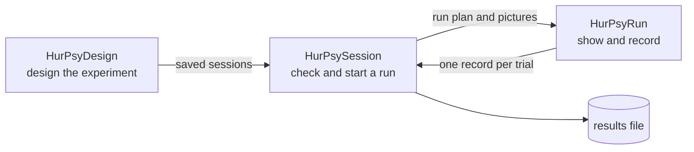

# HurPsy { .home-page }

**HurPsy is a family of three desktop apps for designing
and running computerized psychology experiments, without writing code.**

A researcher builds an experiment on screen out of stimuli, screen locations
and patterns, saves ready-made sessions from it,
and runs those sessions with participants.
Each stage has its own app, so the person who designs an experiment,
the person who prepares the lab computer
and the participant in front of the screen each see only what they need.

-   :material-pencil-ruler:{ .lg .middle } **HurPsyDesign**

    ---

    This is the design app.
    Here you define what participants will see and where it appears,
    arrange it into blocks, trials and steps,
    and decide which responses count as correct.
    You can preview stimuli and whole sessions on the full screen
    at their true size, and save the sessions you need.

-   :material-clipboard-check-outline:{ .lg .middle } **HurPsySession**

    ---

    This is the lab app.
    It opens the saved sessions, checks them before a run,
    keeps track of participants and runs,
    and collects each trial's results as soon as the trial ends.

-   :material-monitor-eye:{ .lg .middle } **HurPsyRun**

    ---

    This is the runner app.
    It shows each step full screen for an exact number of screen refreshes,
    records the participant's response and its timing,
    and reports the moments it showed every picture.

## From an idea to a data file

1. **Design.** You describe the experiment once, in HurPsyDesign,
   by combining building blocks rather than writing scripts.
2. **Build sessions.** HurPsyDesign turns the design into sessions:
   every random choice, such as which picture appears where and in what order,
   is made at this point, and the sessions are saved as files.
3. **Check and run.** HurPsySession opens a session on the lab computer,
   checks it, and hands each run to HurPsyRun.
4. **Record.** HurPsyRun shows the steps
   and sends each trial's record back the moment the trial ends,
   so a run that is cut short still keeps every finished trial.

## The building blocks

An experiment in HurPsy is made of a small number of ideas.
Each of them will get a short illustrated page of its own.

| Idea | What it means |
|---|---|
| **Stimuli** | The things participants see: texts, pictures, shapes, frames and HTML pages. |
| **Locators** | Where things may appear: a point, a rectangle, an arc, a grid or the whole screen. |
| **Sets** | Groups of stimuli, locators or modifiers that a session picks from, so the same design can produce many different trials. |
| **Modifiers** | Changes laid on a stimulus, such as a color, a backdrop behind it or an overlay on top of it. |
| **Patterns** | The structure of an experiment: block patterns hold trial patterns, and trial patterns hold step patterns, the single screens of a trial. |
| **Responses** | The keys and clicks a trial accepts, and which of them are correct. |

Behind the apps, a shared library called **HurPsyLib** holds these ideas
and saves them as plain JSON files.
A later series of pages will introduce its main classes
for readers who want to see how the model works.

## How HurPsy began

This family of projects started with HurPsyLib,
the class library for building experiments in code.
This library was the result of multiple programs
written for some junior researchers' experiments.

Then came HurPsyDesign, an easy-to-use design interface
intended to help the researchers who were unfamiliar with,
or not yet efficient in, the widely used experiment tools
such as PsychoPy, OpenSesame, E-Prime, Presentation, Inquisit and jsPsych.

## Why HurPsy

- **No code.** Experiments are built by picking and arranging,
  not by programming.
- **Variety by design.** Sets and patterns let one design
  produce many balanced sessions.
- **Honest timing.** HurPsyRun counts screen refreshes
  and writes down the actual display times instead of assuming them.
- **Sealed sessions.** Sessions are built and checked before the lab day,
  so a run never makes decisions on the fly.
- **Customizable interface.** HurPsyDesign and HurPsySession let users change the interface language and the overall theme.
  Only English and Turkish are available for now,
  but other language choices will be added in time.

!!! info "Where HurPsy stands"
    HurPsy is in active development and not released yet.
    It is being tested with sample experiments, and a group of researchers
    and the first beta testers will try it next.
    See [Status and directions](status.md) for what works today
    and what comes next.

## Tutorials

Here are some short, illustrated pages
that will walk you through building an experiment
in the HurPsyDesign interface.

- [Tutorial 1: Introduction with a test experiment](tutorial-1-introduction.md),
  a tour of the app with the ready-made Colored Circles experiment.
- [Tutorial 2: Adding stimuli](tutorial-2-adding-stimuli.md),
  starting to build Colored circles experiment on the designer interface
  by adding the circle images as stimuli.
- [Tutorial 3: Adding locators](tutorial-3-adding-locators.md),
  continuing on building Colored circles experiment
  with the adding of locators.
- [Tutorial 4: Building the experiment pattern - Part 1](tutorial-4-experiment-pattern-1.md),
  starting to build the experiment pattern of Colored circles
  by adding stimulus sets and constructing the first step pattern
  with locator-stimulus pairs.
- [Tutorial 5: Building the experiment pattern - Part 2](tutorial-5-experiment-pattern-2.md),
  continuing to build the experiment pattern by duplicating and modifying
  more trial patterns.
- [Tutorial 6: Building the experiment pattern - Part 3](tutorial-6-experiment-pattern-3.md),
  continuing to build the experiment pattern with key response definitions
  and specifying accepted and correct keys in trial patterns.

More pages, each on one idea above, are on their way.
