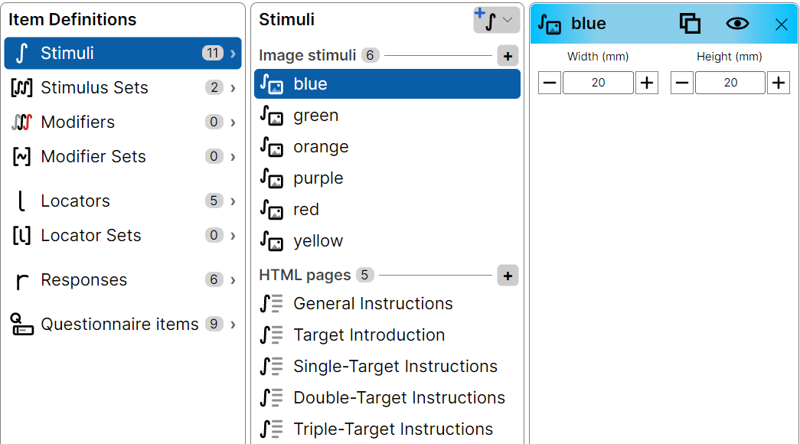
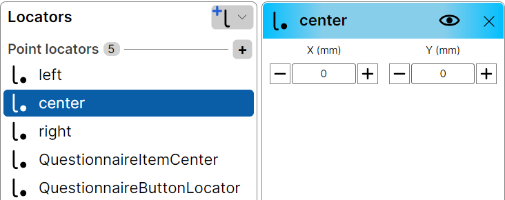
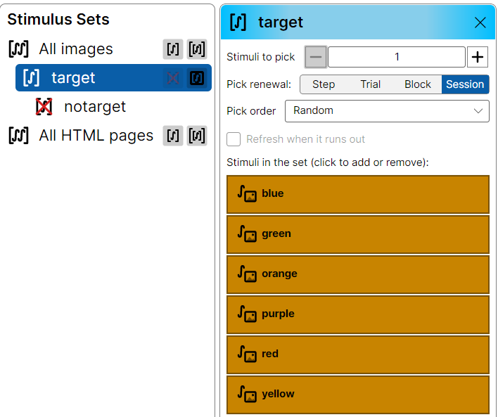
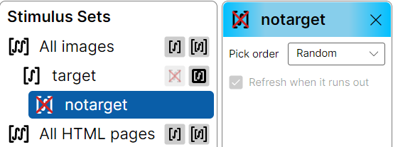
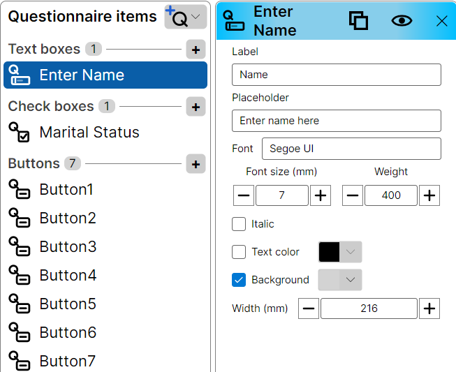
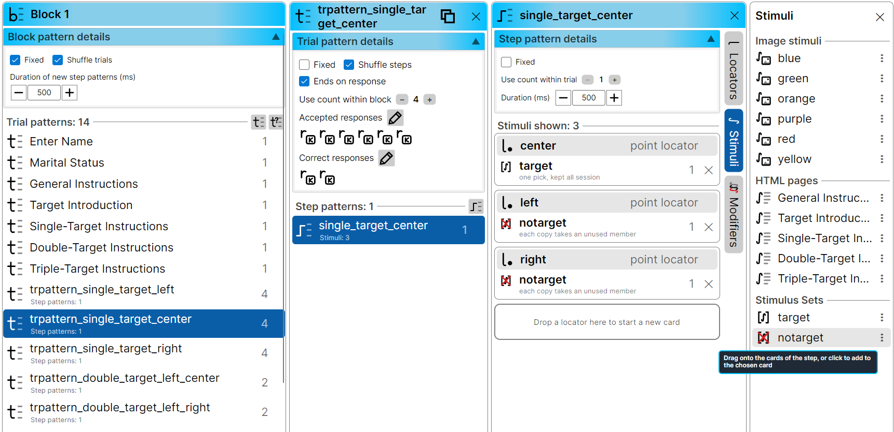
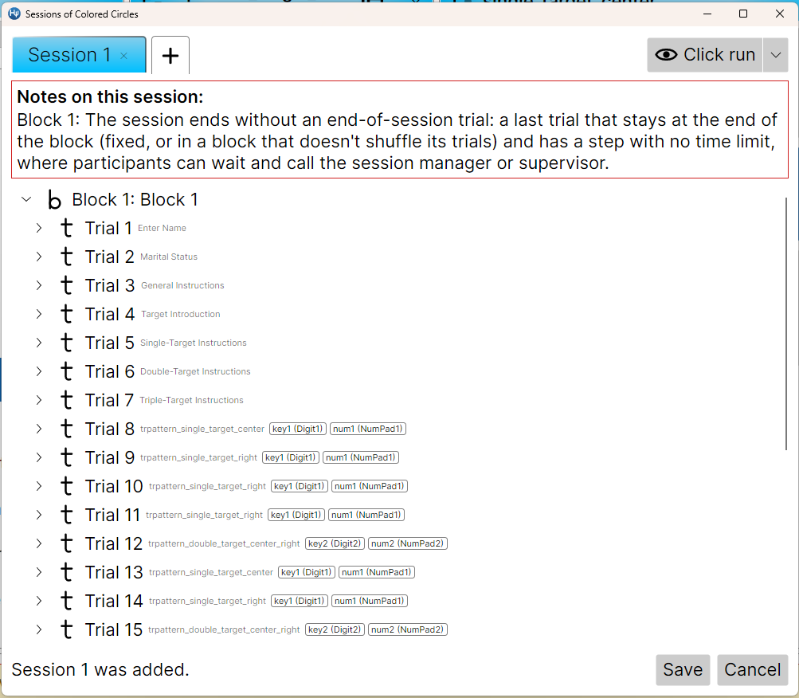

# Tutorial 1: Introduction with a test experiment

--8<-- "version-warning.md"

On this first page we take a tour of **HurPsyDesign**
without building anything ourselves.
We open a small ready-made experiment called **Colored Circles**
and look at its parts one by one.
The later tutorials will build experiments step by step; this one only shows
where things are and what they are for.

Colored Circles is a mock experiment built by code.
In each trial, three colored circles appear side by side for half a second.
One color is the participant's target color for the whole session,
and the participant presses **1**, **2** or **3**
to tell how many of the circles had that color.

## The sliding columns

The window opens on the **Item Definitions** tab.
The experiment's name and description sit above it,
and the **Experiment Pattern** tab next to it
holds the structure of the experiment, which we will see further down.

HurPsyDesign arranges its contents in columns that slide to the right.
The first column lists the kinds of items an experiment can define,
each with the number of items it holds.
When we click a kind, its items appear in the next column;
when we click an item, its details open in the column after that.
Here we clicked **Stimuli** and then the image called **blue**.

The stimuli of this simple experiment are of two kinds:

- **Six image stimuli**, the colored circles.
  Each one is 20 mm wide and 20 mm high.
- **Five HTML pages**, which give the participants their instructions
  before the trials begin.

## Stimuli meet locators

We design an experiment in HurPsyDesign by **pairing stimuli with locators**.
A stimulus says *what* appears, and a locator says *where* it appears.
Colored Circles uses five point locators:
**left**, **center** and **right** for the three circles,
and two more that place the questionnaire items and their buttons.

HurPsy describes every location relative to the screen.
The point (0, 0) is the middle of the screen, X grows to the right
and Y grows upward, as on a sheet of graph paper.
All locations and sizes are given in **millimeters**, never in pixels,
so a 20 mm circle that sits 0 mm from the middle is the same size
and in the same place on any lab screen.
The apps turn millimeters into the pixels of the screen at hand only
when the sessions are prepared and run.

## Sets: letting the session choose

An experiment designer usually will not, and often should not,
tie a particular stimulus to a particular locator.
If the red circle always appeared on the left,
the participants could learn that instead of doing the task.
So we let the session pick the stimuli
from named groups called **stimulus sets**.

Once we add some stimulus objects to an experiment pattern,
the ones of the same type automatically form parent sets
named "All images", "All HTML pages", etc.
We can then define a selection set as a subset of that a parent set.

In this case, we defined our "target" set under the parent set "All images".
Thus, it came with all the image stimuli available as pick choices.
This set will pick one of those choices at the start of every session;
*well, actually, a specialized component will pick one from this set
when it starts building a session*.
In actual runs built from these randomized sessions,
one participant will be responding how many copies of red circles are on every step,
while another will be doing the same for blue circles, and so on.

The circles that are *not* the target come from a second set, **notarget**.
It is an **exclusion set**: it belongs to the target set
and holds whatever the target set did not pick.
Each time the session needs a non-target circle,
notarget hands out one picked randomly.

## Questionnaire items

In addition to pictures and texts, HurPsy can show some familiar controls as
**questionnaire items**: text boxes, check boxes, list boxes and buttons.
HurPsy treats them as visual stimuli that also let the participant enter data.
In this test experiment, we added a text box that asks for a name
and a check box that asks for marital status, before the instructions begin.
*They are included only for demonstration;
actual experiments would probably not ask for that kind of information*.

*The buttons in the list are added automatically,
so that the participants can move on from one questionnaire screen to the next.*

## The experiment pattern

On HurPsyDesign we do not build a session directly;
It helps us build an **experiment pattern**:
rather, we build a pattern that describes what a sessions should contain.
The actual sessions are made from it later,
and every random choice is made at that moment.

On the **Experiment Pattern** tab, the same sliding columns show
a block pattern, its trial patterns
and the step patterns of the selected trial pattern.

**Block 1** holds fourteen trial patterns.
The first seven, from *Enter Name* to *Triple-Target Instructions*,
are used once each.
The other seven describe the counting trials,
one for each way the targets can fall on the three places.

A **trial pattern** is the basis for a given number of real trials in a session.
In the middle column we see the trial pattern for a single target in the center:

- **Use count within block** says how many trials
  the session makes from this pattern; here it is 4.
- **Shuffle steps** mixes the order of the trial's steps,
  and **Ends on response** ends the trial as soon as the participant answers.
- **Accepted responses** are the keys the trial listens to,
  and **Correct responses** are the ones that count as right.
  Colored Circles accepts the keys 1, 2 and 3 on both the top row
  and the number pad; for a single target, 1 on either is correct.
  **HurPsyRun** later uses these definitions to record
  which key the participant pressed and when.

A **step pattern** is the basis for the single screens of a trial.
The right column shows the only step of this trial, which lasts 500 ms.
It has one card per locator, and each card says
which stimuli appear at that location.
The stimuli are not named one by one, though:
the **center** card takes the session's single pick from the target set,
while the **left** and **right** cards
each take an unused member of the notarget set.

The patterns have more properties than these,
and later versions may add new ones or change them.
We will meet the others in the shorter tutorials that build experiments by hand.

## Previewing the sessions

From the **Session** menu, we can build sessions from the experiment pattern
and look at them before we save them.
Each session opens in a tab of its own, with all its trials in order,
and the correct keys of each trial next to it.

HurPsyDesign also checks every session it builds.
Here it leaves a note above the trials:
the session ends without a last trial
in which the participants can wait and call the session manager or supervisor.
A note like this does not stop us,
but it points to something an experienced designer would want to fix
before the lab day.

When we are happy with the sessions, **Save** stores them as files,
ready for **HurPsySession** to check and run on the lab computer.
