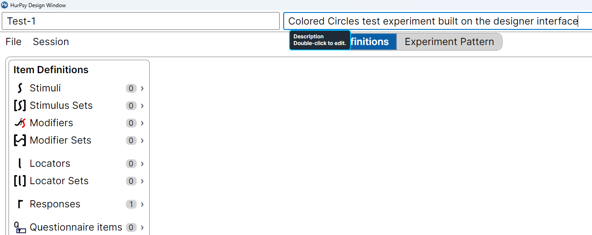
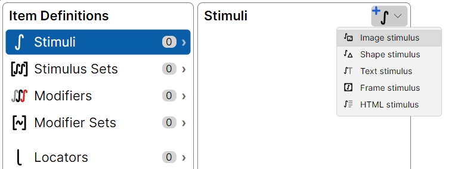
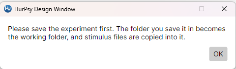
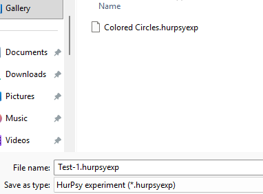
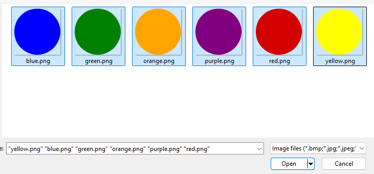
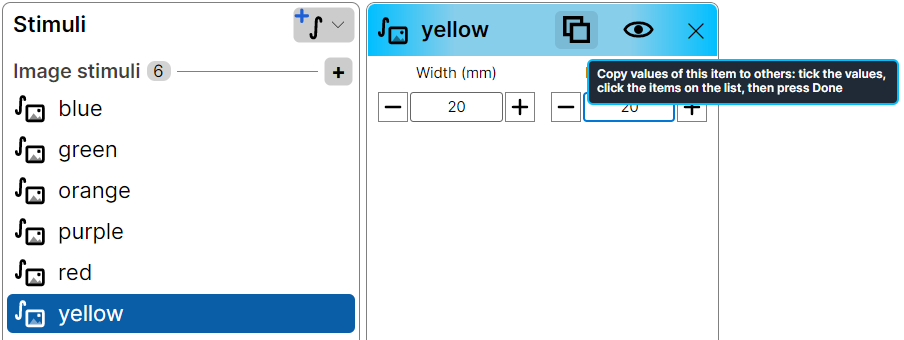
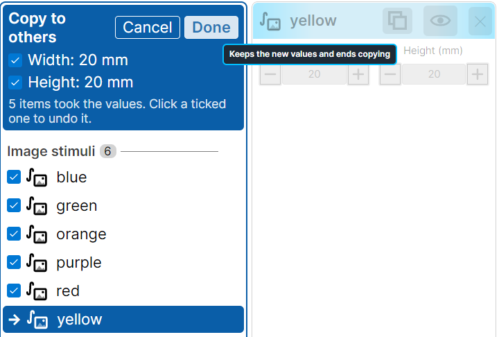
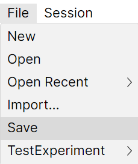

# Tutorial 2: Adding stimuli

--8<-- "version-warning.md"

The **HurPsyDesign** interface starts out with an empty experiment
that has a suggested temporary name and an empty description.
The first step will be to type in a name and a description for the experiment
by double-clicking the relevant text boxes at the top of the window.
Here we name our experiment "Test-1"
and describe it as the Colored Circles test experiment
built on the designer interface,
because on these pages we will build by hand
the experiment that we toured in the first tutorial.

Next we want to add the six colored circles as image stimuli.
We click **Stimuli** in the **Item Definitions** column,
open the list next to the plus button at the top of the **Stimuli** column,
and choose **Image stimulus**.

Before we can pick any image files, however,
HurPsyDesign asks us to save the experiment.
The folder in which we save the experiment file becomes its working folder,
and HurPsyDesign keeps the files of the stimuli in that folder,
so that an experiment file or a session file
always stays together with its stimuli.

When we click **OK**, the save dialog opens.
We save our hand-built experiment as "Test-1.json"
in the same folder as the file of the Colored Circles test experiment,
because the circle images are already there.

Now HurPsyDesign lets us pick the image files.
We select all six circles and click **Open**.

HurPsyDesign adds one image stimulus for each file and names it after the file.
Because the circles are already in the experiment's folder,
HurPsyDesign simply uses them where they are.
Had we picked images from another folder,
it would have copied them into this one first.
A later tutorial will start entirely from scratch and show that case.

The six new stimuli all need the same size, 20 mm wide and 20 mm high.
We click one of them, here **yellow**,
and set its **Width (mm)** and **Height (mm)** to 20.
Rather than repeating these changes in the other five stimuli,
we can let HurPsyDesign copy them.
The copy button at the top of the details column does that,
as its tooltip explains.

When we click the copy button, a **Copy to others** panel opens above the list.
We tick the values that we want to copy, here **Width** and **Height**,
and then click each stimulus that should take them.
Each stimulus that we click gets a tick,
and the panel counts the stimuli that took the values.
If we click a ticked stimulus again, its change is undone.
**Done** keeps the new values and ends copying,
while **Cancel** puts back the old values of all the ticked stimuli.

Finally, we should not forget to save the experiment
with **Save** in the **File** menu.

