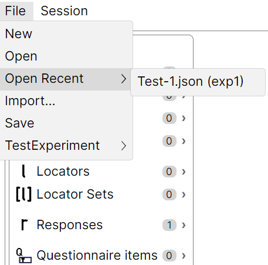
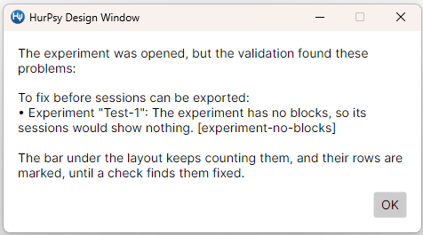
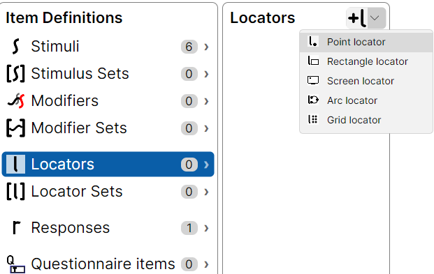
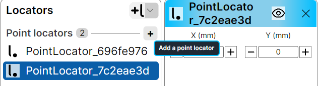
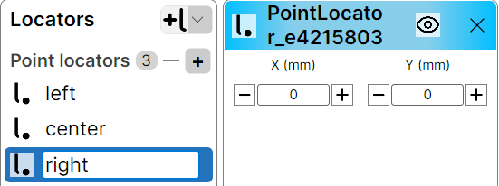
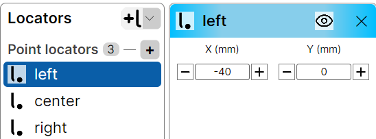

# Tutorial 3: Adding locators

--8<-- "version-warning.md"

A stimulus says *what* appears on the screen, and a **locator** says *where* it appears.
When we define the step patterns, we will pair stimuli with locators.
**HurPsyDesign** will build sessions by referring to those pairings in the step patterns.
In every session step, the locator named in the experiment's step pattern
will assign locations to the stimuli paired with it.
Every locator works in millimeters, so an experiment pattern does not depend on the size
or the resolution of the screen that it will run on.
The point (0, 0) is the middle of the screen, X grows to the right,
and Y grows upward, just as in school geometry.

On this page we will add the three locators
that place the colored circles of our experiment:
one on the left, one in the middle and one on the right.

## Opening the experiment again

We saved our experiment as "Test-1.hurpsyexp" at the end of the second tutorial,
so we can pick up where we left off.
The quickest way is **Open Recent** in the **File** menu,
which lists the experiment files that we opened lately,
together with the folders they are in.

Our experiment is far from complete,
so HurPsyDesign opens it with a list of the problems that its validation found.
Here the only problem is that the experiment has no blocks yet,
which means that its sessions would show nothing.
We need not worry about such warnings while we are still building an experiment.
The bar under the layout keeps counting the problems,
and the warnings will disappear
once we complete the definition of the experiment.

## Choosing a locator type

We click **Locators** in the **Item Definitions** column
and open the list next to the plus button at the top of the **Locators** column.
The list offers five kinds of locator:

- A **Point locator** is a single fixed point,
  so every stimulus paired with it appears at exactly that place.
- A **Rectangle locator** is an area with a center, a width and a height,
  and it places a stimulus at a random point inside that area.
- A **Screen locator** is a rectangle like the previous one,
  but its center and its size are given as fractions of the screen size,
  for designs that should fill whatever screen they run on.
- An **Arc locator** has a number of points at regular intervals along a circle
  or a part of a circle.
- A **Grid locator** has a point in the middle of each cell of a grid.

The arc and grid locators never put two stimuli at the same point in one step,
and each of their points can also be used as a point locator of its own.

The Colored Circles experiment that we toured in the first tutorial
shows its circles at three fixed places,
so we choose **Point locator**
as we try to recreate it on the designer interface.

## Adding point locators

Unlike an image stimulus, a point locator does not come from a file,
so there is nothing to pick.
HurPsyDesign simply adds a new point locator with a temporary name
and shows its details on the right.
The locators are grouped by their kind,
and a small plus button appears next to the name of the group,
**Point locators**.
As its tooltip says, this button adds another point locator,
so we click it until we have three of them.

## Renaming the point locators

The temporary names will not help us remember which locator is which,
so we can, and probably should, give them better names.
When we double-click the name of a locator in the list,
it turns into a text box, and we can type in the new name.
We name our three locators **left**, **center** and **right**.

## Setting the coordinates

Finally, we place each locator at its point.
We click a locator in the list
and type its coordinates in the **X (mm)** and **Y (mm)** boxes of its details,
or we change them step by step with the minus and plus buttons beside the boxes.
A new point locator starts at (0, 0), the middle of the screen.

Our three locators are all on the horizontal line
through the middle of the screen, 40 mm apart:

- The **left** locator is at (-40, 0).
- The **center** locator is at (0, 0),
  so it can keep the coordinates that it started with.
- The **right** locator is at (+40, 0).

When the three locators are in place,
we save the experiment with **Save** in the **File** menu once more.
