# Tutorial 4: Building the experiment pattern - Part 1

--8<-- "version-warning.md"

In this tutorial we continue our work on "Test-1.hurpsyexp",
our hand-built copy of the Colored Circles test experiment,
in the **HurPsyDesign** interface.
We already have the six colored circle images
from the second tutorial
and the three point locators from the third.
When we open this file from the list of recent files,
the list of validation problems greets us again.
Again, we will ignore it and move on.

We are now ready to start building the experiment pattern,
whose options and distribution patterns dictate
how a session of the experiment is built.
This requires a **block pattern**,
which is the blueprint of a session block.
A block pattern is a collection of **trial patterns**,
and each trial pattern is, in turn,
a collection of **step patterns**.
Our goal on this page is to build our first step pattern.

A step pattern describes the stimuli
that will appear together on the same session step.
We build it by pairing stimuli with the locators
that will assign their places on the screen.
In our experiment, every session step displays
one colored circle at each of the three point locations.

We could build a step pattern by pairing
each point locator with a specific colored circle,
but then we would be building
all possible session steps, one by one.
Instead, we should pair the locators with **stimulus set**s.
Then one step pattern can describe 2,4,10, or even more
lineups of circles, all built with random selections
from the sets we define.

## The target set

We open the column for the item definitions of
Stimulus Sets. There, we already see the parent set
"All images", the one automatically formed with
the image stimuli we have added so far.

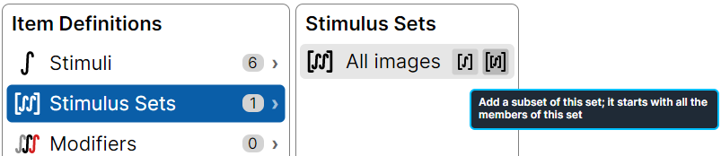

We create ther stimulus set named **target**
as a subset of this parent set,
by pressing the first button on the right of its label.
The target image which will be tracked by participants
will be selected from this set.
In the details of the set, we have the six colored
circle images already selected.

They are automatically the candidates for the target image.
We could select only a few of them to serve as the target,
if your experiment design required a smaller set of choices.
We will leave them as they are.
We leave **Stimuli to pick** at 1,
and we set **Pick renewal** to **Session**,
so the pick is made once and kept for the whole session.

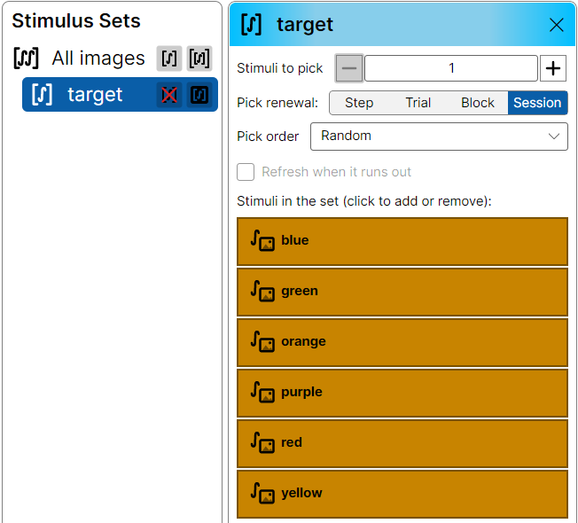

A session of this experiment picks its target at random from this set,
and then asks how many copies of that target image were in a given step.
Thanks to the random selection, not all participants see the same target,
so their responses depend more on the patterns used to build the sessions.

## The set of non-targets

Next we need a special set that holds all the image stimuli
other than the one selected as the target for the whole session.
This requires creating an **exclusion set**
attached to the target set.
We add by pressing the first button
on the right of the target set's label',
the one whose tooltip is shown on the picture below.

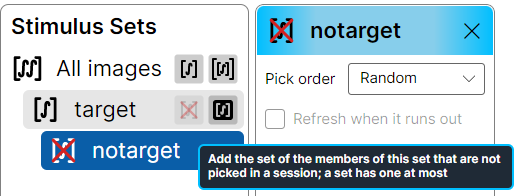

We name the new set **notarget**.
We don't put any stimuli in it ourselves.
Its association with the target set lets
HurPsyDesign know which image stimuli to put in it:
once the target is picked for a session,
notarget holds all the other images.

The **Pick order** of notarget is **Random**,
so each spot that takes a non-target gets
one of the other circles at random.
Sometimes the same circle may fill both spots
left open by the single target,
and sometimes two different circles may appear on them.

## Adding a block pattern and a trial pattern

We now switch to "Experiment pattern" view
and add a block pattern by pressing the button
with b and pattern lines next to it.

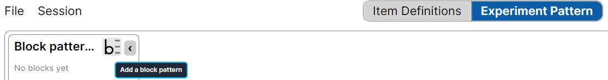

We double-click the block pattern label
to rename it as "Block1"
*because we don't have a better name to indicate its purpose*. 

Then we add a trial pattern to it by pressing the button
with a t and pattern lines next to it.
*Do you see a pattern here?*

We name the trial pattern **single-target-left**,
because its step will show the single target circle on the left.
*Now, this one has a purpose and a name to go with it*.
We leave the other details of the block pattern as they are, for now.

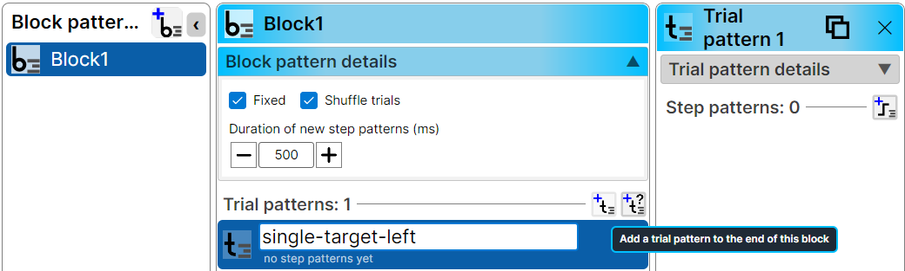

## Adding a step pattern

In the column of the trial pattern, we add a step pattern
by pressing the button you must have guessed.
We give this step pattern the same name as its parent.
The new step pattern shows nothing yet,
and its own column opens on the right.

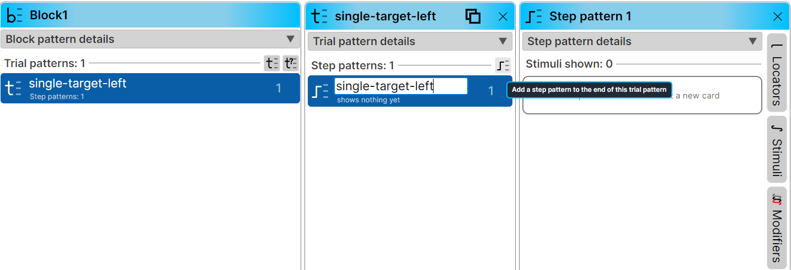

!!! info "One pattern, many trials"

    A session will have more than one trial based on this trial pattern.
    All of them will show the single target image on the left,
    but with different combinations of the images that are not targets.
    Later there will also be other trial patterns,
    with steps that pair the target with one, two and three locators.

    The good thing about defining such patterns is that we need only one definition
    for all the session trials based on one particular combination.
    Names that tell which combination each pattern represents
    make the whole experiment pattern easy to understand.
    They will also prove useful later,
    when we decide which key responses each pattern will accept as correct.

## Pairing sets with locators

Now we build the step pattern by pairing stimulus sets, rather than individual stimuli,
with the locators.
Drag-and-drop actions are intended to make this part of the job easier.
The tabs on the right edge of the step pattern open the **Locators**, **Stimuli** and **Modifiers** lists.
We open **Locators** and drag **left**, **center** and **right** onto the step pattern,
and each locator starts a card of its own.

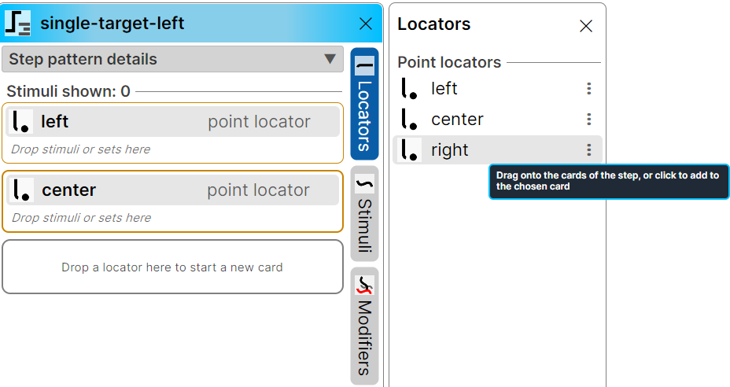

Next we open **Stimuli**, which lists the image stimuli and the stimulus sets,
and drag **target** onto the card of the **left** locator.

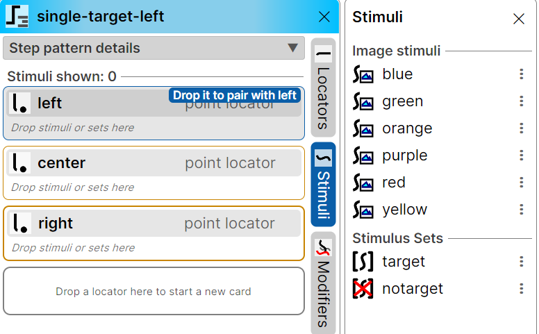
*We took this screenshot just before we dropped the target stimulus item
on the card with locator left; that's why it doesn't show the stimulus yet.*

Then we drag **notarget** onto the **center** and **right** cards.
The rows on the cards sum up each pairing:
the target is one pick kept all session,
and each copy of notarget takes a random member of the set.

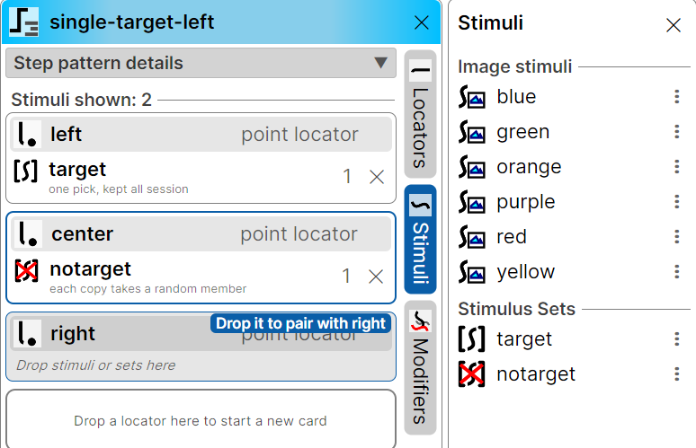

## Previewing a session

Our experiment pattern now has just one trial with a single step,
but that's enough to build a session.
We click the button that builds sessions from the experiment,
and the **Sessions of Test-1** window opens with **Session 1**.
The tree shows the block, the trial and the step,
together with the three images picked for the step.
The notes above the tree say that the session has no
end-of-session trial yet,
and we will come back to fix that in a later tutorial.

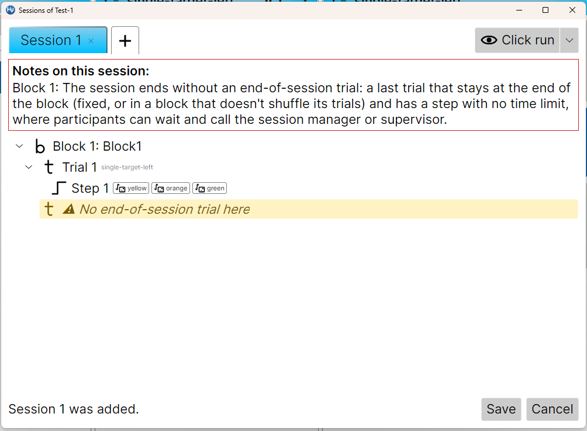

With **Click run**, we can see a step as a participant would see it,
with the target circle (yellow) on the left and
two non-target circles in the middle and on the right.

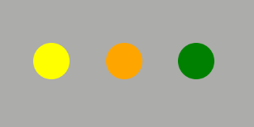
