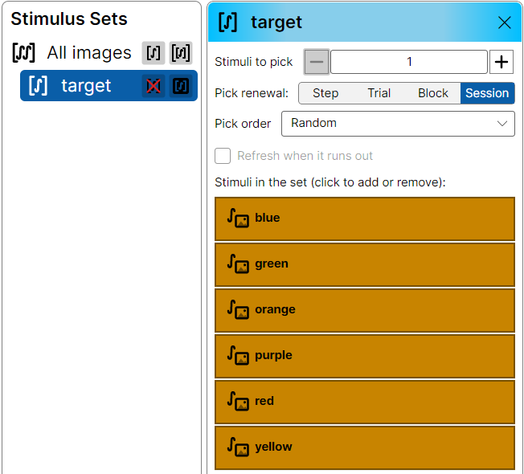
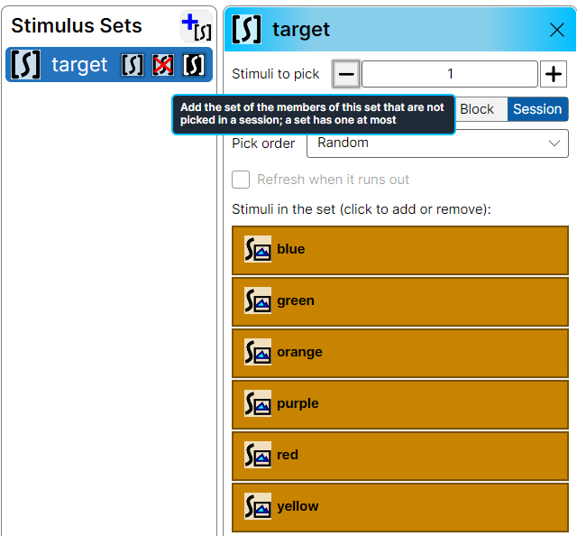
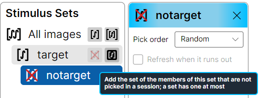
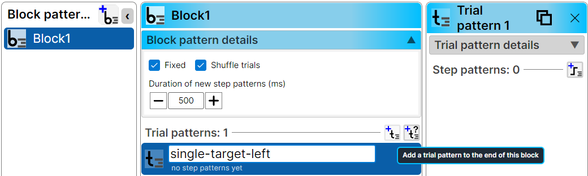
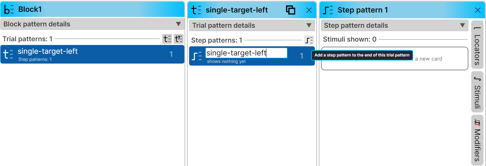
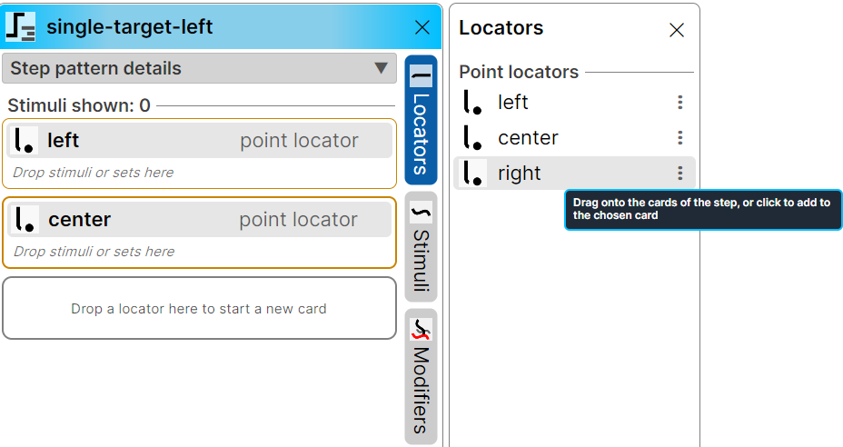
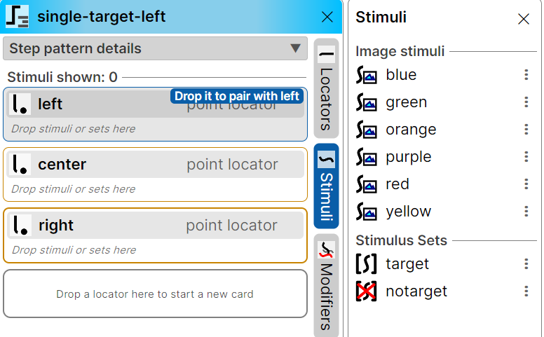
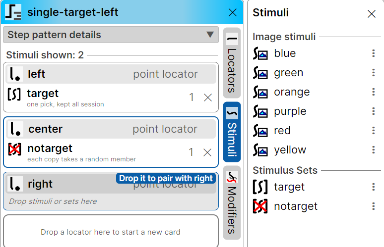
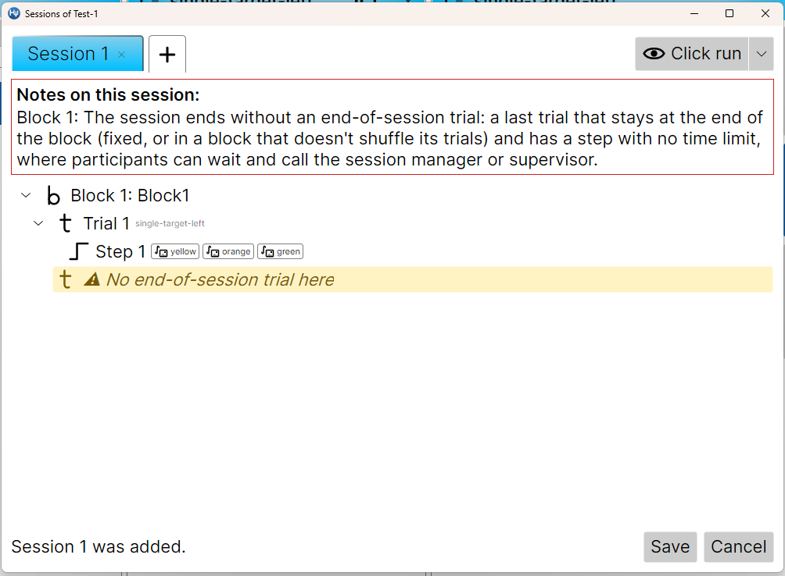
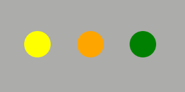

# Tutorial 4: Building a step pattern

--8<-- "version-warning.md"

In this tutorial we continue our work on "Test-1.json",
our copy of the Colored Circles test experiment,
in the **HurPsyDesign** interface.
We already have the six colored circle images from the second tutorial
and the three point locators from the third.
The list of validation problems still greets us when we open the file,
but we covered it in the third tutorial, so we can close it and move on.

We are now ready to start the experiment pattern,
whose options and distribution patterns dictate how a session of the experiment is built.
This requires a **block pattern**, which is the blueprint of a session block.
A block pattern is a collection of **trial patterns**,
and each trial pattern is, in turn, a collection of **step patterns**.
Our goal on this page is to build our first step pattern.

A step pattern describes the stimuli that will appear together on the same session step.
We build it by pairing stimuli with the locators that will assign their places on the screen.
In our experiment, every session step displays one colored circle at each of the three point locations.

We could build a step pattern by pairing each point locator with a specific colored circle,
but then we would actually be building all the possible session steps, one by one.
In experiment design, an experiment is normally a description of how a session should be built,
with rules on how stimuli and locators are combined.
A good way to set up those rules is to start with sets from which objects are selected at random.
The selections establish the session steps,
and the patterns build upward from the steps all the way to the session itself.
On this page we meet the first of these selection sets, a **stimulus set**,
and see how HurPsyDesign lets us define it.

## The target set

First we create a stimulus set named **target**, from which the target image will be selected.
In the details of the set, we click the six colored circles to add them to the set.
We leave **Stimuli to pick** at 1, and we set **Pick renewal** to **Session**,
so the pick is made once and kept for the whole session.

A session of this experiment picks its target at random from this set,
and then asks how many copies of that target image were in a given step.
Thanks to the random selection, not all participants see the same target,
so their responses depend more on the patterns used to build the sessions.

## The set of non-targets

Next we need a special set that holds all the image stimuli
other than the one selected as the target for the whole session.
This requires creating an **exclusion set** attached to the target set.
The button next to the name of the target set adds it,
and as its tooltip says, a set can have one exclusion set at most.

We name the new set **notarget**.
We don't put any stimuli in it ourselves.
Its association with the target set lets HurPsyDesign know which image stimuli to put in it:
once the target is picked for a session, notarget holds all the other images.

The **Pick order** of notarget is **Random**,
so each spot that takes a non-target gets one of the other circles at random.
Sometimes the same circle fills both spots left open by the single target,
and sometimes two different circles appear with it.

## Adding a trial pattern to the block

We add a block pattern named **Block1**.
Then we add a trial pattern to it with the button that adds a trial pattern to the end of the block.
We name the trial pattern **single-target-left**,
because its step will show the single target circle on the left.
We leave the other details of the block pattern as they are for now.

## Adding a step pattern

In the column of the trial pattern, we add a step pattern and give it the same name.
The new step pattern shows nothing yet, and its own column opens on the right.

## Pairing sets with locators

Now we build the step pattern by pairing stimulus sets, rather than individual stimuli,
with the locators.
Drag-and-drop actions are intended to make this part of the job easier.
The tabs on the right edge of the step pattern open the **Locators**, **Stimuli** and **Modifiers** lists.
We open **Locators** and drag **left**, **center** and **right** onto the step pattern,
and each locator starts a card of its own.

Next we open **Stimuli**, which lists the image stimuli and the stimulus sets,
and drag **target** onto the card of the **left** locator.

Then we drag **notarget** onto the **center** and **right** cards.
The rows on the cards sum up each pairing:
the target is one pick kept all session,
and each copy of notarget takes a random member of the set.

## Previewing a session

Our experiment pattern now has enough in it to build a session.
We click the button that builds sessions from the experiment,
and the **Sessions of Test-1** window opens with **Session 1**.
The tree shows the block, the trial and the step,
together with the three images picked for the step.
The notes above the tree say that the session has no end-of-session trial yet,
and we will come back to that in a later tutorial.

With **Click run**, we can see a step as a participant would see it,
with the target circle on the left and two non-target circles in the middle and on the right.
This picture comes from another session,
and that is how randomization works in building sessions.
Every time HurPsyDesign builds a session, it makes its own random picks:
another target for the whole session,
and other non-targets for the spots left open around it.

