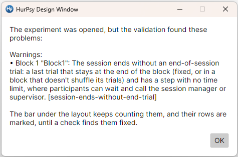
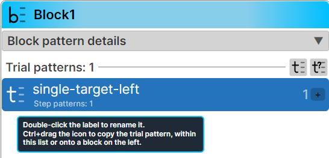
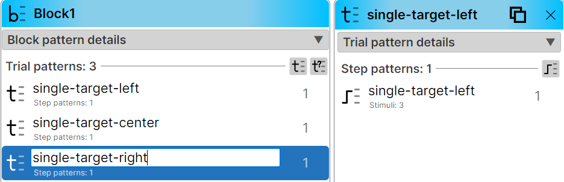
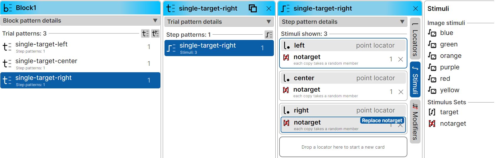
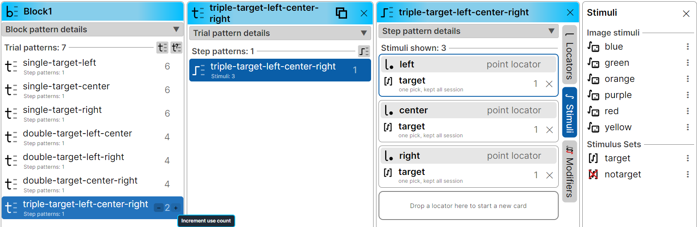

# Tutorial 5: Building the experiment pattern - Part 2

--8<-- "version-warning.md"

In this tutorial, we continue our work on "Test-1.hurpsyexp",
our hand-built copy of the Colored Circles test experiment,
in the **HurPsyDesign** interface.
We will now add more trial patterns to the experiment pattern.

Again, we will ignore the list of validation problems
that now complains about the lack of some special trials
and some unset property values.
*We promise, we will eventuallu add them, and fix them*.

## Cloning trial and step patterns

A trial pattern or a step pattern can easily be duplicated
by dragging its icon image while pressing the CTRL button
on the keyboard.

We will make use of this feature to easily create 
two more trial patterns which will also a single target image
on their steps, but on the other two point locators.

Well, renaming the new trial patterns will not be of much
until we also rename the single steps they contain.
We also need to modify the locator-stimulus pairings
to fit the names we chose for the step patterns.

Here, for example, we are switching the stimulus
paired with point locator right from notarget to target:

We keep using the cloning feature to also produce
trial 9and step) patterns displaying two or three targets,
while being extra careful with names and locator-stimulus pairs.

We then decide on use counts for the trial patterns:

We can increment and decrement the use counts of trial patterns
by using the - and + buttons that appear when the mouse pointer
hovers on the number box. Those numbers specify how many session
trials must be produced based on these patterns.
*Yes, setting these numbers before cloning trial patterns
would have made job easier*.

