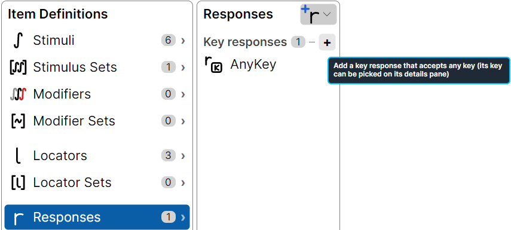
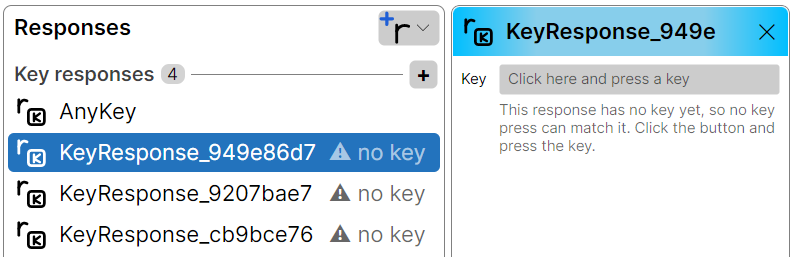
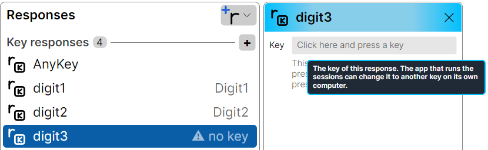
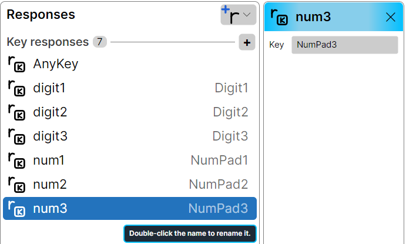
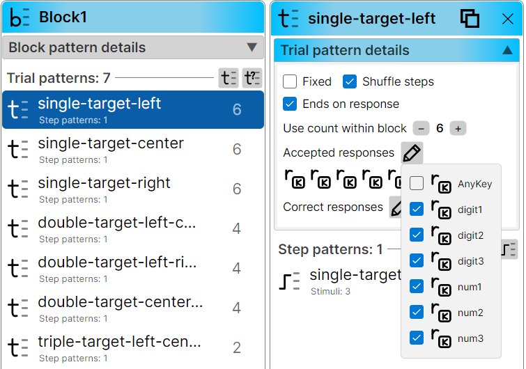
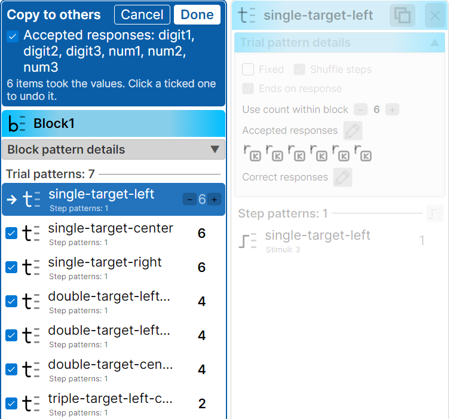
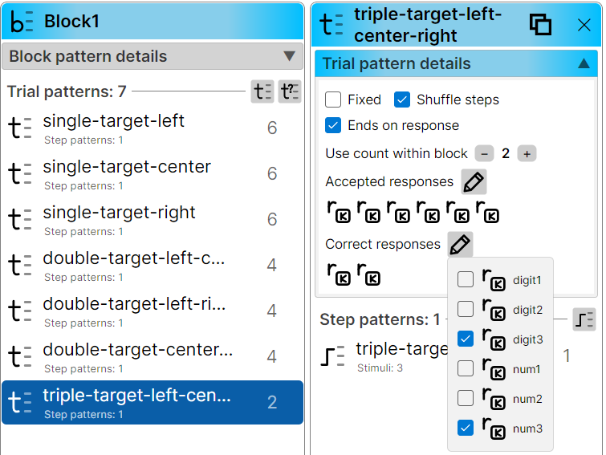

# Tutorial 6: Building the experiment pattern - Part 3

--8<-- "version-warning.md"

In this tutorial, we continue our work on "Test-1.hurpsyexp"
in the **HurPsyDesign** interface.
We will define the key responses the participants can give
and specify which ones will be accepted
and deemed correct in session trials.

*Yes, we are still ignoring the persisting validation errors.*.

## Participant's responses

When a psychology experiments is running on a computer,
the participant is often expected to respond in some way
to what is put up on the screen.

If the participants' reactions are not being recorded passively,
such as by eye-tracking devices, simple tests rely on
click and key responses.

Here, in this mock experiment, we will ask the participants
to respond by pressing a key indicating the number of copies
of the target image.

We already noted there will be 1, 2, or at most 3 copies
of the target image on any step.
Therefore, a participant can press keys of digits 1, 2, and 3,
either on the digits row, or on the numeric keypad.

## Key Response definitions

We click on the definitions list of "Responses" on the left column.

We see the pre-defined **AnyKey** key response definition there.
That one, if accepted as an answer, will let the participant
to end a trial by pressing any key on the keybaord.

We can add the key responses we want by pressing small + button
right next to the "Key responses" category title.

We click on that three times and we will have added
three key responses with temporary names:

Understandably, our app is warning us that none of them
correspond to any physical key on the keyboard.

It will also be a good idea to give them names we can remember.
Right after we set the name of a key response,
we click on the textbox on the right column
and click on to specify the physical key it corresponds to:

!!! info "Keys and key codes"
	
	HurPsy apps rely on automatically incrementing key codes
	starting from 1 to identify key responses.
	*AnyKey has key code 0*.
	This provides and extra layer of security against
	incompatible operating systems and different keyboard layouts.
	If HurPsyDesign simply used the physical key code
	assigned by the OS it runs on,
	maybe that code would not work
	on a lab computer with a different setup.
	Besides, key responses are supposed to be convenient
	to press on and not every keyboard layout
	assigns the same positions to specific keys.
	As indicated by the tooltip in the picture above,
	session managers will be able to replace
	physical key assignments on lab computers.
	The sessions will run the same, since they used
	their own key codes instead of the codes of the keyboards.

We also add three more response definitions
for the numeric keypad's 1, 2, and 3 keys:

## Specifying accepted and correct responses in trial patterns

The final step is specifying which of these keys session trials
will accept and record as a correct response.

We click on a trial pattern and look into its details panel.
There, we check the boxes for all key responses
which will be accepted by a session trial based on 
this trial pattern:

*We decided to not let a participant respond
by pressing any key; only the keys with digits 1, 2, 3 are allowed.*

We can take a shortcut and press the copy to others button
on the title bar to copy the list of accepted responses
to all other trial patterns.

However, we will have to specify the correct responses
by picking one (not one, two) responses for each trial pattern:

*Here the meaningful names we chose helped us a great deal*.